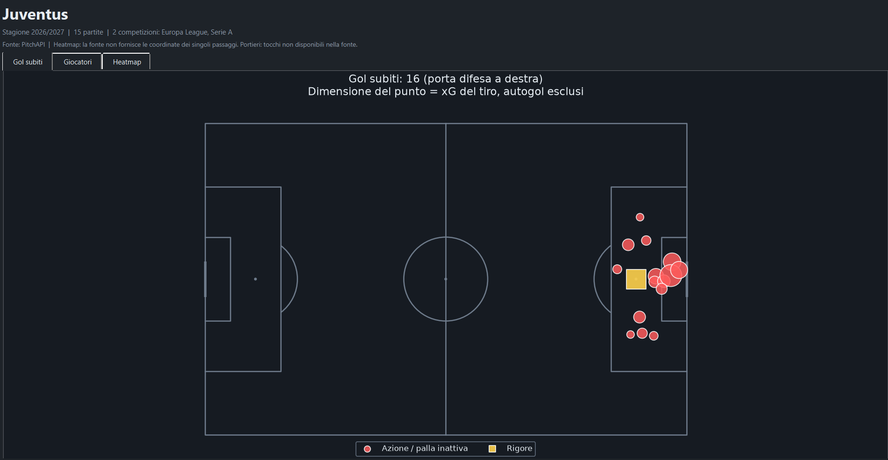
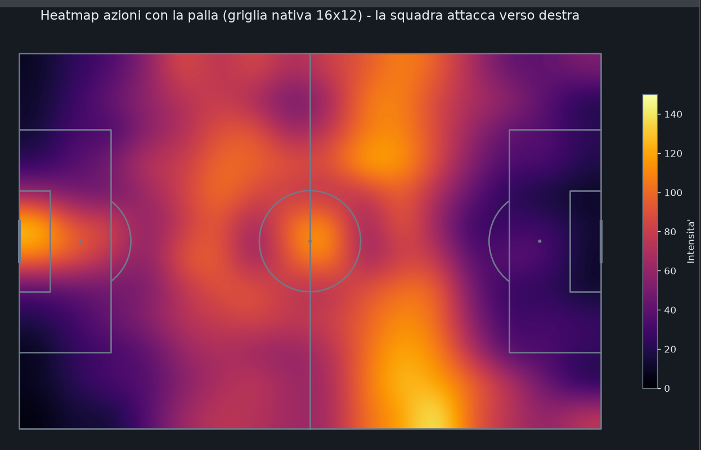
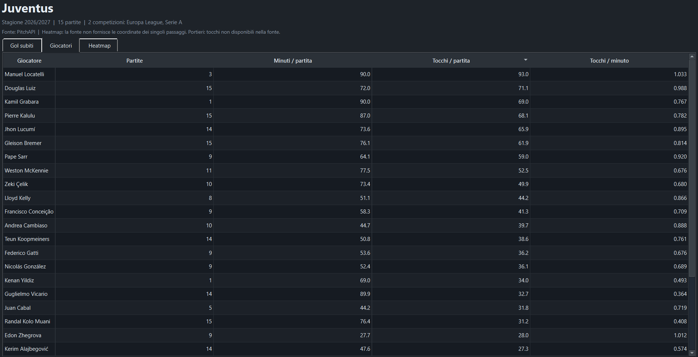

# ⚽ Football Team Viewer


A fast, dark-themed desktop application built with **PySide6** and **mplsoccer** to analyze any football team's tactical footprint, conceded goals (xG), and player workload across multiple competitions.

## ✨ Key Features

- **Conceded Goals Shot Map**: Visualizes the pitch coordinates of every goal conceded (excluding own goals), scaled by **Expected Goals (xG)** and distinguishing open-play/set-piece goals from penalties.
- **Sortable Player Workload Table**: Tracks appearances, average minutes per match, average ball touches, and **touches-per-minute** efficiency ratio.
- **Tactical Heatmaps**:
  - **PitchAPI mode**: 16×12 native ball-action grid across the current season, with toggleable bicubic interpolation.
  - **StatsBomb mode**: High-resolution 2×2 yard Gaussian-smoothed pass heatmap on historical open data.
- **Smart CLI Team Resolver**: Case-insensitive, accent-insensitive search with fuzzy matching (`difflib`) when a team name is misspelled.
- **Fast & Cached**: Multithreaded API fetching (`ThreadPoolExecutor`) with local disk caching (`~/.cache/football_viewer`) to avoid redundant network calls.

## 📸 Screenshots

| Conceded Goals (xG Map) | Tactical Heatmap | Player Workload |
| :---: | :---: | :---: |
|  |  |  |

## 🚀 Installation

1. **Clone the repository:**
   ```bash
   git clone [https://github.com/aleBErto00/football-team-viewer.git](https://github.com/aleBErto00/football-team-viewer.git)
   cd football-team-viewer